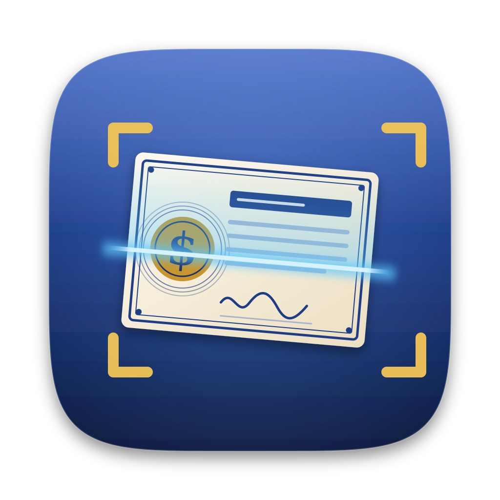
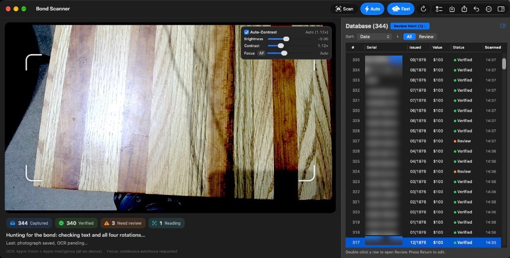

# Bond Scanner for macOS

<p align="center">
  
</p>

<p align="center">
  <strong>Fast, native, and 100% private scanning and auditing for US Paper Savings Bonds.</strong>
</p>

<p align="center">
  
  
  
  
</p>

---

<p align="center">
  
</p>

**Bond Scanner** is a native macOS application designed to quickly digitize, catalogue, and audit collections of United States paper savings bonds (**Series E**, **Series EE**, and **Series I**). 

Using Apple's Vision framework and continuous camera feeds (webcam or iPhone Continuity Camera), Bond Scanner automatically detects bonds, captures high-resolution photographs, extracts key metadata, validates serial formats, and maintains a local inventory.

**Your financial data remains strictly yours:** All processing, OCR, image storage, and database operations execute 100% locally on your Mac. No images, names, Social Security numbers, or serial numbers are ever transmitted over the network.

---

## Highlights

- ⚡ **Hands-Free Auto-Capture**: Point the camera at a bond. The app detects rectangular boundaries, waits for motion to settle, and automatically snaps a high-resolution frame.
- 🔍 **Real-Time Vision OCR**: Extracts series, denomination ($10 to $10,000), serial numbers, issue month/year, and red cancellation/dating stamps with series-specific validation heuristics.
- 🔎 **Interactive Review Workbench**:
  - **Hovering Magnifying Loupe (2.8x)**: Inspect faint serials, cancellation stamps, and issue dates effortlessly.
  - **Smooth Zoom & Pan**: Pinch-to-zoom on trackpads or use `⌘+Scroll` / `⌥+Scroll`.
  - **Smart Discrepancy Highlighting**: Easily identify missing or uncertain fields with color-coded status badges.
  - **Apple Intelligence Integration**: On-device AI analysis to help resolve ambiguous, worn, or low-contrast characters.
  - **Safe Deletion (`⌘⌫`)**: Easily purge accidental or errant captures with a single confirmation shortcut.
- 🔒 **Zero-Cloud, Crash-Resilient Storage**:
  - High-resolution original photos saved locally to `~/BondScans/photos/`.
  - WAL-backed SQLite database (`bonds.sqlite3`) with schema migrations and automatic duplicate deduplication.
  - Live, auto-syncing `bonds.csv` and `records.json` exports kept in sync with every edit.
- ⚙️ **Hardware Camera Controls**: Live auto-contrast, manual brightness/contrast sliders, autofocus trigger, and camera device switching.

---

## Quick Start & Installation

### Requirements
- **Operating System**: macOS 14.0 (Sonoma) or macOS 15.0+ (Sequoia)
- **Architecture**: Apple Silicon (M1/M2/M3/M4) or Intel Mac
- **Camera**: Built-in Mac camera, USB document camera / webcam, or an iPhone with Continuity Camera

### Option 1: Fast One-Command Install (Recommended)

From the project root in Terminal, run:
```bash
./build.sh --install
```
This compiles the release binary and installs it directly into `~/Applications/BondScanner.app`.

### Option 2: Build with Xcode

If you prefer building within Xcode:
1. Install [XcodeGen](https://github.com/yonaskolb/XcodeGen) (if not already installed):
   ```bash
   brew install xcodegen
   ```
2. Generate and open the project:
   ```bash
   xcodegen generate
   open BondScanner.xcodeproj
   ```
3. Press **⌘R** to build and run. *(Configured with ad-hoc signing; no paid developer account required).*

---

## User Guide

### 1. Setting Up Your Camera
- Place your paper bond flat under good, even lighting (a document camera stand or desk mount works best).
- Toggle **Auto-Contrast** on for automatic histogram stretching, or fine-tune **Brightness** and **Contrast** using the HUD sliders on the video preview.
- Toggle between **Fast** and **High Quality** camera resolutions in the toolbar depending on your camera's frame rate.

### 2. Scanning Bonds
- **Automatic Mode**: Align the paper bond within the viewfinder brackets. Once the bond edges stabilize for a couple of frames, the app automatically triggers a high-resolution photo and runs OCR.
- **Manual Mode**: Press the **Scan** button in the toolbar (or press **Space**) to snap immediately.
- The bottom status HUD will display real-time feedback: *"Hunting for bond"*, *"Photo saved, OCR pending"*, or validation warnings.

### 3. Reviewing & Editing
Double-click any entry in the database list (or click the blue **Review Next** banner) to open the Review Window:
- **Hovering Loupe**: Hover your cursor over the photograph on the left to activate the 2.8x circular magnifying glass.
- **Zooming**: Use trackpad pinch-to-zoom, `⌘+Scroll`, or the toolbar zoom controls (`+`, `-`, `Actual Size`).
- **Editing Fields**: Click into any field (Series, Denomination, Serial, Issue Date) to adjust values. Bond Scanner validates inputs against official Treasury rules in real time.
- **AI Assistance**: Click **Analyze with AI** to invoke local Apple Intelligence models for suggestions on difficult characters.
- **Deleting Errant Scans**: Click **Delete** or press **⌘⌫** to remove a false capture. The record is removed from the database and exports, and the photo is safely moved to the macOS Trash.

---

## Keyboard Shortcuts

| Shortcut | Action | Where |
| :--- | :--- | :--- |
| **Return** | Open Review for selected record / Edit field | Main Window Table |
| **⌘S** | Save changes and mark as verified | Review Window |
| **⌘⌥S** / **Return** | Save & Next (advance to next review item) | Review Window |
| **⌘⌫** | Delete current record & trash photo (with confirmation) | Review Window |
| **⌘R** | Revert unsaved edits | Review Window |
| **⌘→** / **⌘←** | Navigate to Next / Previous record | Review Window |
| **L** | Toggle hovering magnifying loupe | Review Window |
| **+** / **-** | Zoom photo in / out | Review Window |
| **0** | Reset photo zoom to 100% | Review Window |
| **⌘,** | Open Settings (storage location & backups) | Everywhere |

---

## Data Storage & Privacy

All application data is kept locally in your chosen collection directory (defaults to `~/BondScans/`):

```text
~/BondScans/
├── bonds.sqlite3         # Authoritative SQLite database (WAL-journaled)
├── bonds.sqlite3-wal     # SQLite Write-Ahead Log
├── bonds.sqlite3-shm     # SQLite Shared-Memory index
├── photos/               # Full-resolution original photos (original_*.jpg)
├── bonds.csv             # Auto-synchronized CSV export for Excel / Numbers
├── records.json          # Formatted JSON export for programmatic access
└── scan-debug.log        # Diagnostic capture & OCR evaluation log
```

### Changing Storage Location & Backups
- Go to **Bond Scanner → Settings…** (`⌘,`) to move or select a custom collection folder (e.g. an encrypted volume or external drive).
- **CSV Formula Sanitization**: All CSV exports automatically sanitize formula injection characters (`=`, `+`, `-`, `@`) to protect against spreadsheet vulnerabilities.
- **Disaster Recovery**: Backups can be scheduled or exported via SQLite's atomic `VACUUM INTO` command. To preserve both data and imagery, ensure you back up the entire `~/BondScans/` folder.

---

## Architecture & Codebase

```text
Sources/
├── Camera/      # AVFoundation camera discovery, 4K/1080p formats, and photo capture
├── Models/      # BondRecord schema, status enums, and OCR data models
├── Review/      # Review queue coordinator, background AI analysis, and deletion logic
├── Services/    # SQLite DatabaseManager, CSV/JSON StorageManager, and logger
├── UI/          # AppKit camera view, review window, zoomable photo view, and loupe
└── Vision/      # Edge detection, orientation normalization, series & date parsers
```

### Running Tests & Verification

Bond Scanner includes a comprehensive suite of unit and integration tests (200+ tests) verifying serial number patterns, denomination heuristics, cancellation stamp parsing, and review workflows:

```bash
# Run local verification and test suite
./scripts/local-ci.sh

# Or run directly via xcodebuild
xcodebuild test -project BondScanner.xcodeproj -scheme BondScanner
```

### Private Local OCR Regression Framework
To test against real, private paper bond photos without committing sensitive financial or personal data, Bond Scanner includes an isolated regression framework in `Tests/BondScannerTests/PrivateOCRRegressionTests.swift`. 

All directories under `local-fixtures/` (synthetic, real, and reports) are strictly ignored by `.gitignore`. See `local-fixtures.example.json` for details on structuring local ground-truth evaluation manifests.

---

## License

Distributed under the MIT License. See [LICENSE](LICENSE) for more information.
